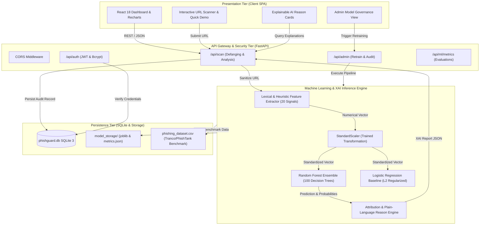

# SYSTEM ARCHITECTURE SPECIFICATION
## PhishGuard: Explainable Machine Learning-Based Phishing URL Detection System

---

### 1. HIGH-LEVEL ARCHITECTURAL OVERVIEW
PhishGuard adopts a 4-tier modular client-server architecture engineered for security, high-throughput heuristic processing, and model interpretability.

---

### 2. DETAILED SUBSYSTEM BREAKDOWN

#### 2.1 Presentation Subsystem (Frontend)
- **Framework:** React.js 18.2 with Vite bundler.
- **Styling Architecture:** Tailwind CSS using custom brand theme variables:
  - `#101827` Primary Navy Canvas
  - `#152033` Elevated Surface Cards
  - `#F8FAFC` Clean Text Contrast
  - `#27D17F` Electric Green Brand Identity & Safe Metric Badge
- **State & Routing:** Context API (`AuthContext`) for centralized session tokens, React Router DOM 6 for protected route guarding.
- **Data Visualization:** Recharts SVG components rendering 7-day scanning volume, categorical threat breakdown, and MDI feature importance charts.

#### 2.2 API & Security Subsystem (Backend)
- **Framework:** FastAPI utilizing ASGI `uvicorn` server worker.
- **Session Security:** OAuth2 password flow with JWT Bearer Token encryption (`HS256`, 24-hour expiration).
- **Input Sanitization:** URL input syntax validation and RFC compliance verification with complete absence of browser pre-fetching.
- **Defanging Engine:** Transforms sensitive URLs into defanged tokens (`hxxps[://]domain[.]com`) before storing in relational tables.

#### 2.3 Machine Learning & Explainable AI (XAI) Engine
- **Feature Extraction:** 20 distinct numerical features:
  - *Structural:* URL length, path length, query parameter count, subdomain depth, protocol TLS flag.
  - *Lexical & Syntactic:* Hyphen counts, dot counts, hex percent symbols, `@` symbol credential tricks, double slash redirects.
  - *Behavioral / Adversarial:* Shortening service detection (bit.ly, tinyurl, etc.), brand squatting hyphenation, sensitive keywords (`login`, `verify`, `account`, `banking`, `appleid`, etc.).
  - *Information-Theoretic:* Shannon Character Entropy $H(X) = -\sum p(x) \log_2 p(x)$ to detect DGA patterns.
- **Inference Pipeline:** Random Forest ensemble classifier with Gini impurity metric and 100 decision trees.
- **XAI Engine:** Compares extracted features against normative internet baselines, quantifying score contributions (+/- points) and delivering plain-language diagnostic descriptions.

#### 2.4 Persistence Subsystem
- **Relational Storage:** SQLite 3 database (`phishguard.db`) with foreign key enforcement and indexed queries.
- **Artifact Storage:** Serialized machine learning models (`model.joblib`, `scaler.joblib`) and empirical metric reports (`metrics.json`, `dataset_provenance.json`).

