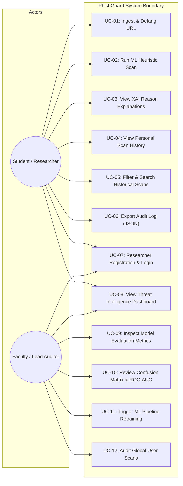

# USE CASE DIAGRAM & SPECIFICATION
## PhishGuard: Explainable Machine Learning-Based Phishing URL Detection System

---

### 1. USE CASE DIAGRAM (MERMAID)

---

### 2. DETAILED USE CASE SPECIFICATIONS

#### Use Case UC-02: Run ML Heuristic Scan
- **Primary Actor:** Student / Security Researcher.
- **Preconditions:** User navigates to `/scanner` (either logged in or as guest evaluator).
- **Trigger:** User enters URL and clicks "Analyze URL" or selects an academic evaluation quick-test pill.
- **Main Flow:**
  1. System validates URL string against RFC format rules.
  2. System transforms URL into defanged representation (`hxxps[://]domain[.]com`).
  3. Feature extractor parses 20 numerical parameters (Shannon entropy, subdomain depth, shortening flags, keyword counts).
  4. Vector is evaluated by the loaded Random Forest model.
  5. System computes risk score ($0-100$), classification (`safe`, `suspicious`, `phishing`), and confidence percentage.
  6. XAI engine constructs plain-English explanatory contribution cards.
  7. Results are persisted to SQLite and displayed to user.
- **Exception Flow:** If URL contains illegal whitespace or cannot be parsed, system displays validation warning without contacting the server.

#### Use Case UC-11: Trigger ML Pipeline Retraining
- **Primary Actor:** Faculty Examiner / Lead Auditor (Admin Role).
- **Preconditions:** Admin is authenticated with valid JWT bearer token carrying `role: admin`.
- **Trigger:** Admin clicks "Trigger Pipeline Retrain" on `/admin`.
- **Main Flow:**
  1. API receives POST request at `/api/admin/retrain`.
  2. Dataset builder compiles documented benchmark dataset (Tranco/PhishTank).
  3. Feature extraction processes samples with stratified 80/20 train/test split.
  4. Standard Scaler is fit strictly on training set to avoid data leakage.
  5. Both Logistic Regression and Random Forest models are fitted.
  6. Evaluation metrics (Accuracy, Precision, Recall, F1, ROC-AUC, Confusion Matrix) are computed on the test set.
  7. Persisted artifacts (`model.joblib`, `metrics.json`) are updated on disk.
  8. Fresh metrics are returned and updated dynamically in the admin view.

