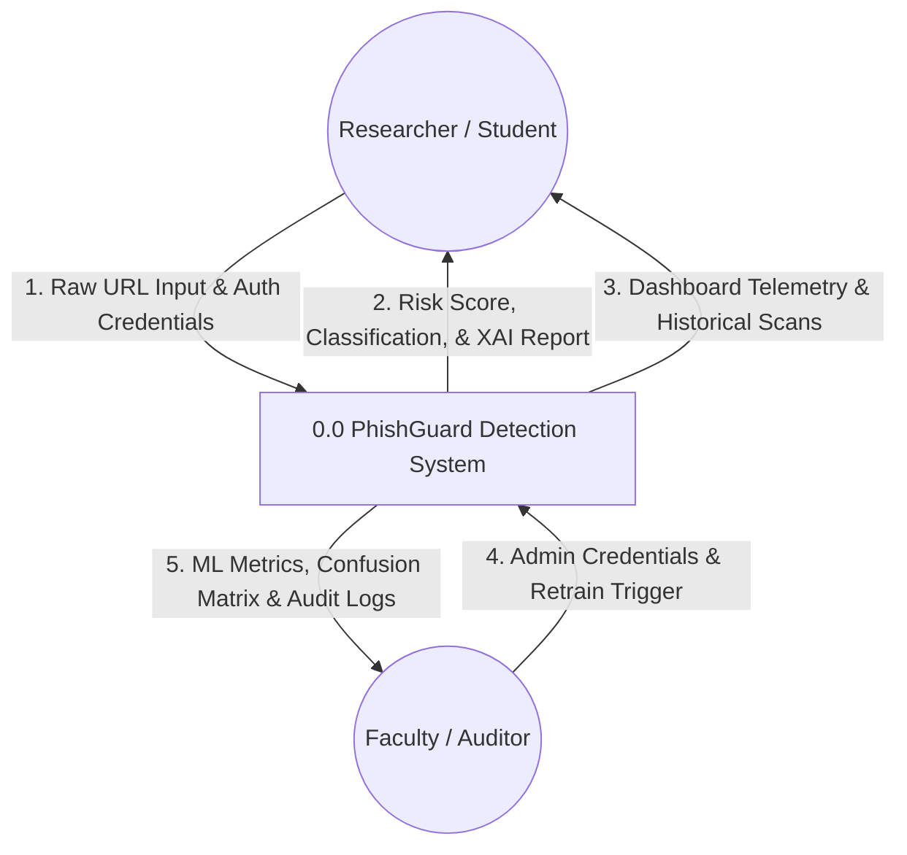
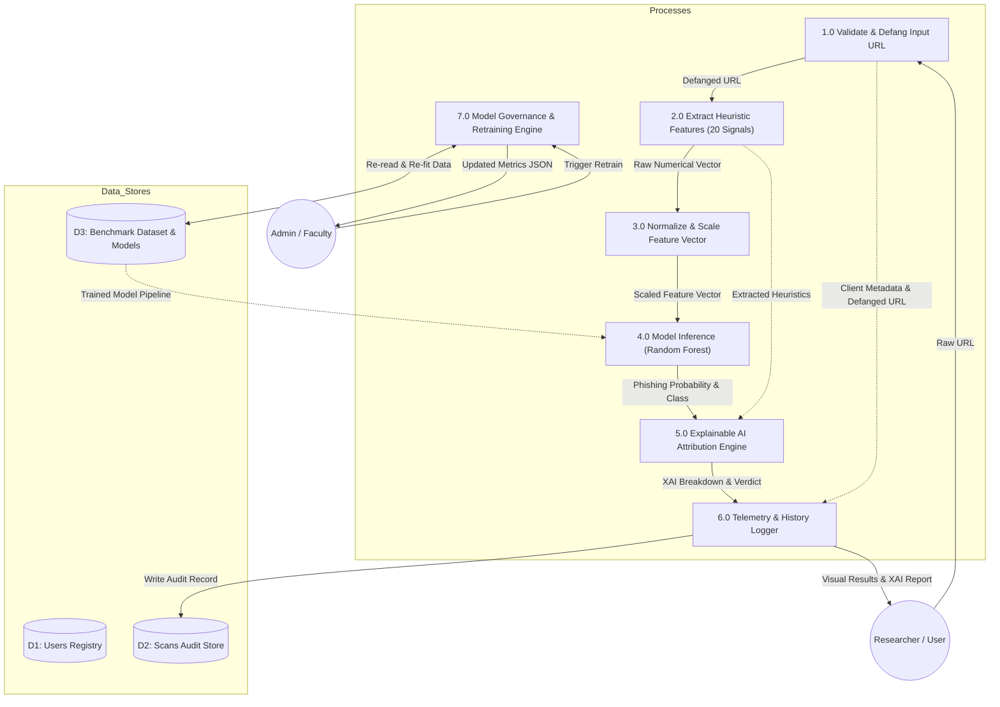

# DATA FLOW DIAGRAMS (DFD)
## PhishGuard: Explainable Machine Learning-Based Phishing URL Detection System

---

### 1. DFD LEVEL 0: CONTEXT DIAGRAM

The Context Diagram defines the external boundary of PhishGuard, illustrating data inflows and outflows between human actors and the centralized system entity.

---

### 2. DFD LEVEL 1: FUNCTIONAL DECOMPOSITION

The Level 1 DFD decomposes process `0.0` into sub-processes: Input Sanitization, Feature Engineering, Machine Learning Inference, Explainability Attribution, and Telemetry Persistence.

---

### 3. PROCESS DATA DICTIONARY

| Process ID | Name | Input Data Flows | Output Data Flows | Transformation Description |
| :--- | :--- | :--- | :--- | :--- |
| **P1.0** | Validate & Defang | Raw URL String | Defanged URL, Target Host | Verifies RFC syntax; transforms `http://` to `hxxp[://]`, replaces domain dots with `[.]`. |
| **P2.0** | Feature Extraction | Defanged URL, Host | 20-D Numerical Feature Vector | Computes character entropy, counts dots, hyphens, subdomains, checks IP format, scans keyword list. |
| **P3.0** | Normalize & Scale | 20-D Vector | Scaled Vector $\hat{X}$ | Applies trained `StandardScaler` mean and variance parameters without leakage. |
| **P4.0** | Model Inference | Scaled Vector $\hat{X}$ | Probability $P \in [0,1]$ | Passes vector across 100 decision trees to derive class vote and ensemble probability. |
| **P5.0** | XAI Attribution | Heuristics, Probability | Structured XAI List | Compares each feature against normative threshold, calculating score contribution and plain-English reasons. |
| **P6.0** | Telemetry Logger | XAI Report, User ID | Persisted Row, UI DTO | Commits transaction to SQLite `scans` table and packages JSON response for client. |
| **P7.0** | Retrain Engine | Admin Token | Metrics Summary | Executes stratified 80/20 train/test split on Tranco/PhishTank data and updates joblib artifacts. |

