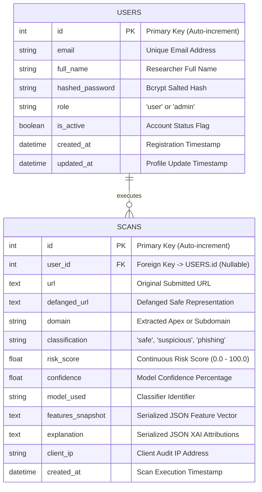

# DATABASE ENTITY-RELATIONSHIP (ER) SPECIFICATION
## PhishGuard: Explainable Machine Learning-Based Phishing URL Detection System

---

### 1. ENTITY-RELATIONSHIP DIAGRAM (MERMAID)

---

### 2. RELATIONAL DATA DICTIONARY

#### 2.1 Table: `users`
Stores authenticated student researchers and administrative evaluators.

| Column | Data Type | Constraints | Description |
| :--- | :--- | :--- | :--- |
| `id` | `INTEGER` | `PRIMARY KEY AUTOINCREMENT` | Unique identifier for researcher account. |
| `email` | `VARCHAR(255)` | `UNIQUE NOT NULL, INDEXED` | Valid academic or research email address. |
| `full_name` | `VARCHAR(255)` | `NOT NULL` | Full name of researcher/student. |
| `hashed_password` | `VARCHAR(255)` | `NOT NULL` | Salted Bcrypt cryptographic hash. |
| `role` | `VARCHAR(50)` | `NOT NULL DEFAULT 'user'` | Access control role (`user` or `admin`). |
| `is_active` | `BOOLEAN` | `NOT NULL DEFAULT 1` | Active state flag. |
| `created_at` | `DATETIME` | `NOT NULL DEFAULT CURRENT_TIMESTAMP` | Account creation timestamp (UTC). |
| `updated_at` | `DATETIME` | `NOT NULL DEFAULT CURRENT_TIMESTAMP` | Last profile update timestamp (UTC). |

#### 2.2 Table: `scans`
Stores permanent audit logs of all analyzed URLs and their explainable machine learning outputs.

| Column | Data Type | Constraints | Description |
| :--- | :--- | :--- | :--- |
| `id` | `INTEGER` | `PRIMARY KEY AUTOINCREMENT` | Unique scan audit serial number. |
| `user_id` | `INTEGER` | `NULLABLE, FK -> users(id) ON DELETE SET NULL` | Linked researcher account (null for guest scans). |
| `url` | `TEXT` | `NOT NULL` | Raw URL submitted for inspection. |
| `defanged_url` | `TEXT` | `NOT NULL` | Defanged non-clickable representation (`hxxps[://]...`). |
| `domain` | `VARCHAR(255)` | `NULLABLE, INDEXED` | Extracted host domain name. |
| `classification` | `VARCHAR(50)` | `NOT NULL, INDEXED` | Categorical label (`safe`, `suspicious`, `phishing`). |
| `risk_score` | `FLOAT` | `NOT NULL` | Calibrated numerical risk score ($0.0$ to $100.0$). |
| `confidence` | `FLOAT` | `NOT NULL` | Model confidence probability percentage. |
| `model_used` | `VARCHAR(100)` | `DEFAULT 'Random Forest Classifier'` | Machine learning model name. |
| `features_snapshot`| `TEXT` | `NOT NULL` | JSON serialized extracted 20-feature dictionary. |
| `explanation` | `TEXT` | `NOT NULL` | JSON serialized XAI attribution reasons and impact weights. |
| `client_ip` | `VARCHAR(100)` | `NULLABLE` | Client IP address for security audit trails. |
| `created_at` | `DATETIME` | `NOT NULL, INDEXED` | Scan creation timestamp (UTC). |

---

### 3. DATABASE OPTIMIZATION & INTEGRITY RULES
1. **Foreign Key Enforcement:** SQLite does not enforce foreign keys by default. The backend enables the `PRAGMA foreign_keys = ON;` connection directive dynamically via SQLAlchemy events.
2. **Indexing Strategy:**
   - `users.email`: B-Tree index for $O(1)$ login lookups.
   - `scans.classification`: Index for fast filtering on the audit history dashboard.
   - `scans.created_at`: Index for 7-day temporal telemetry aggregation.
   - `scans.domain`: Index for sub-string search operations.
3. **Audit Immutability:** Scan records are timestamped with monotonic UTC clocks to prevent tampering during viva examinations.

